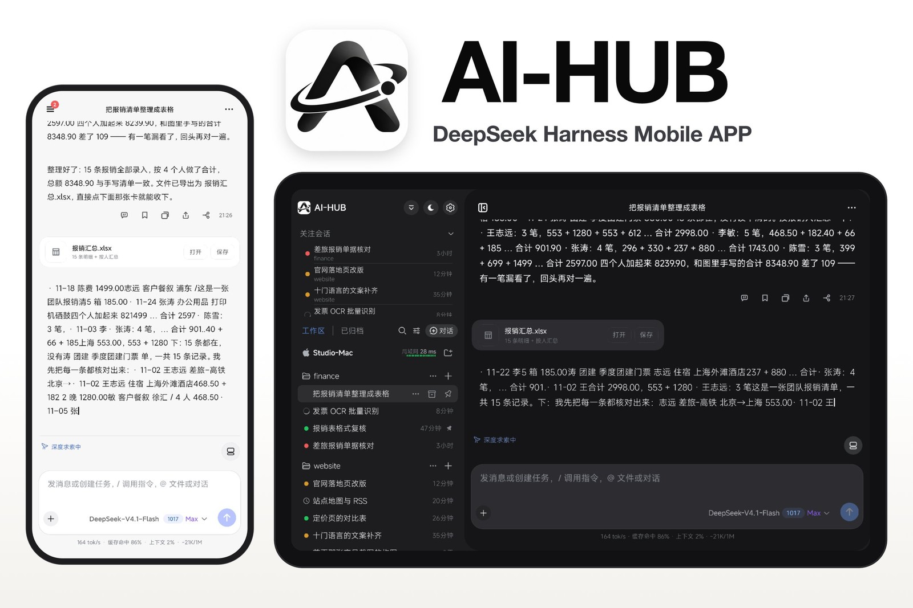
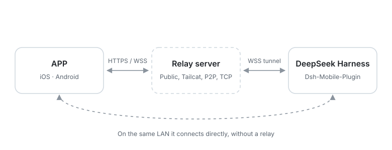
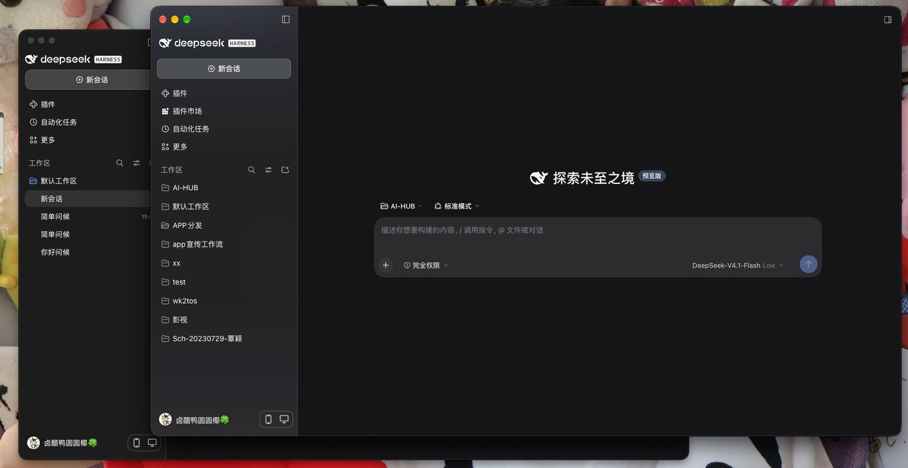
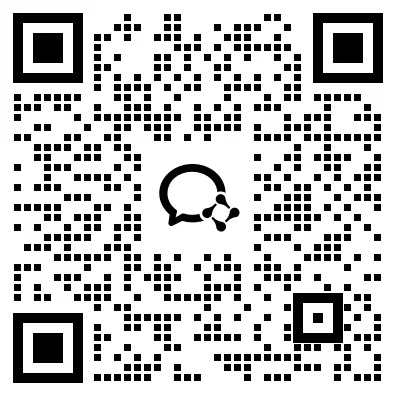

<h3 align="center">AI-HUB mobile plugin</h3>

<p align="center">
  
</p>

<p align="center">
  <a href="https://app.wnluo.com/api/public/apps/14/download-latest"></a>
  <a href="https://github.com/WNLUO/dsh-mobile-plugin/releases/latest/download/ai-hub-android.apk"></a>
  <a href="https://apps.apple.com/us/app/ai-hub/id6821681438"></a>
  <a href="https://testflight.apple.com/join/4fn5PCMD"></a>
</p>

<p align="center">
  <a href="https://www.npmjs.com/package/dsh-mobile-plugin"></a>
  
  
  <a href="README.md"></a>
</p>

<p align="center">Control your DeepSeek Harness remotely</p>

**This is the plugin for DeepSeek Harness.** Once installed, you can reach your DeepSeek Harness over the network — browse sessions, keep chatting, manage files and workspaces, with progress synced live. It raises your productivity and frees you from being tied to the production environment.

What sets it apart from most DeepSeek Harness plugins: **this app is not a web wrapper. It is built for real production work — not designed for gimmicks or novelty; everything is guided by raising productivity.**

<p align="center">
  <picture>
    <source media="(prefers-color-scheme: dark)" srcset="https://raw.githubusercontent.com/WNLUO/dsh-mobile-plugin/main/assets/connection-en-dark.svg">
    
  </picture>
</p>

It connects to **your own DeepSeek Harness**, not to some cloud service.

## Features

### Sessions and workspaces

- Create, resume, rename, and search sessions — or fork any of them into a branch that runs on its own.
- Create, rename, delete, pin, and archive workspaces from the phone; the order you set there syncs back to the desktop.
- Replies stream in chunk by chunk, so you see the text while it is still being written, and tool calls land in real time.
- Reading a session on the phone clears its unread dot on the desktop; sidebar expansion state stays in sync.

### Everything you would otherwise walk back for

- **Approvals and questions**: the same cards that pop up on the desktop show up on the phone — permission requests, single choice, multi-select, and free-form answers are all tappable.
- **Queue a line mid-run**: add something while a turn is running and it lands right after the current step.
- **Git**: status and diff, stage, commit, push, switch branches; let the model draft the commit message.
- **Files**: browse directories, read files, and send files from the phone back to the computer, where they land in a fixed inbox directory.
- **Plugins**: search, install, update, and remove plugins from the marketplace on the phone; the plugin can also upgrade itself.
- **Models**: switch models at any time, see which channels and models are available, and configure locally defined channels from the phone.
- **Schedules and subagents**: list scheduled tasks, create and edit them, pause, resume, run one now, or delete it; watch running subagents, interrupt one, or send it a line.

### Connection

- Two ways in: back over the relay v2 tunnel from anywhere, or straight through the LAN proxy on the same Wi-Fi.
- Pairing codes with an optional pairing policy; device credentials can be revoked one by one or all at once.
- Optional iOS push notifications; leaving it off affects nothing else.

The mobile API exposes only what the phone needs (`/api/mobile/v1/*`) — no shell, no system settings, no arbitrary file writes.

## Remote computer

When you would rather not carry your main computer around, you can drive its full DSH web interface from another computer. Generate a one-time binding on computer A, tap once on computer B, and A's full web interface opens through a local address — no domain, no phone involved.

<p align="center">
  
</p>

The window opens in the desktop display shell the plugin ships, laid out like the official desktop app on Mac; each visit lasts an hour and renews automatically. Details and how to revoke are in [docs/remote-computer.md](docs/remote-computer.md).

## Install and update

Installing the phone app is only the first step; the plugin on this side is what connects it.

In DeepSeek Harness, open **Settings → Plugins**, search for and install `dsh-mobile-plugin`, then open **Settings → Mobile → Open configuration page** to pair. The pairing QR code, the current listening address and the relay status all live on that page, and everything the phone does starts there. The plugin updates automatically; an update usually does not need a DeepSeek Harness restart.

To run on a server with no display, see [headless deployment and config endpoints](docs/headless-deploy.md) — local endpoints, the mobile API and session cleanup are documented there.

## Why I built this

DeepSeek Harness runs on my computer, and I am not always sitting in front of it. Out of the house, in another room, lying in bed — when I want to know how far a task got, or it is stuck on an approval waiting for me to tap, the only option used to be walking back.

The starting point is that narrow: this does not squeeze the whole DeepSeek Harness onto a phone screen. It lets you see, keep talking, and tap the thing that needs tapping after you leave the desk.

That made two constraints hard. One is networking: no public IP, no port forwarding on the router, no DDNS set up just to use it once — the plugin dials out from the local network and the phone comes back along that tunnel. The other is capability: the phone gets only the openings it needs — sessions, approvals, file transfer, some configuration — but not a shell and not arbitrary file writes. If the phone is lost or picked up by someone else, the damage is bounded and knowable.

## Alternatives

**Opening the DeepSeek Harness web interface in a mobile browser**: nothing to install, but you have to remember the address every time, the layout is sized for a desktop, and you navigate by pinch-zooming and dragging. No push notifications either, so the moment you leave the page you know nothing — and approvals are the worst of it, since they need a precise tap.

**Remote desktop**: you are still operating that screen, with the phone as a monitor. Lose the network and you get a black screen, and on a small display every action starts with zooming in.

**The mobile apps from AI assistant vendors**: those run on the vendor's servers, and your sessions, files, and quota live there. This connects to the DeepSeek Harness on your own computer, with models you configured and files on your own disk.

## Contact

<p align="center">
  
</p>

Scan the code above to join our WeCom group. **If it will not scan or says it has expired**, email <admin@wnluo.com> for a fresh one, or open an issue.

If that is awkward, email <admin@wnluo.com> or <wnluo2@gmail.com>. If it works well for you, a star on the repository is the most concrete way to help.

Privacy policy: [PRIVACY.md](PRIVACY.md). Support and FAQ: [SUPPORT.md](SUPPORT.md).

## Sponsorship & partnership

Companies or products that want to support the project's long-term maintenance can see the [sponsorship & partnership page](https://ai-hub.wnluo.com/sponsor) — or email <admin@wnluo.com> about working together. Sponsorship funds ongoing maintenance and releases; it buys acknowledgement and a channel to talk, not feature unlocks and not special privileges, and it does not imply any affiliation with, or endorsement by, DeepSeek. Individuals who want to help can star the repository, use the "Donate" entry in the app's settings, or support via [Afdian](https://ifdian.net/a/AI-HUB) (WeChat Pay / Alipay).

## Development

```sh
pnpm install --frozen-lockfile
npm test
```

If you changed anything under `React/`, run `pnpm run build` there first and commit the generated `lib/panel/index.html` together with the source.

If a web plugin needs to keep the web top bar on the phone's chat page, see [keeping the chat top bar](docs/chat-embed.md).

## License

MIT, see [LICENSE](LICENSE).
