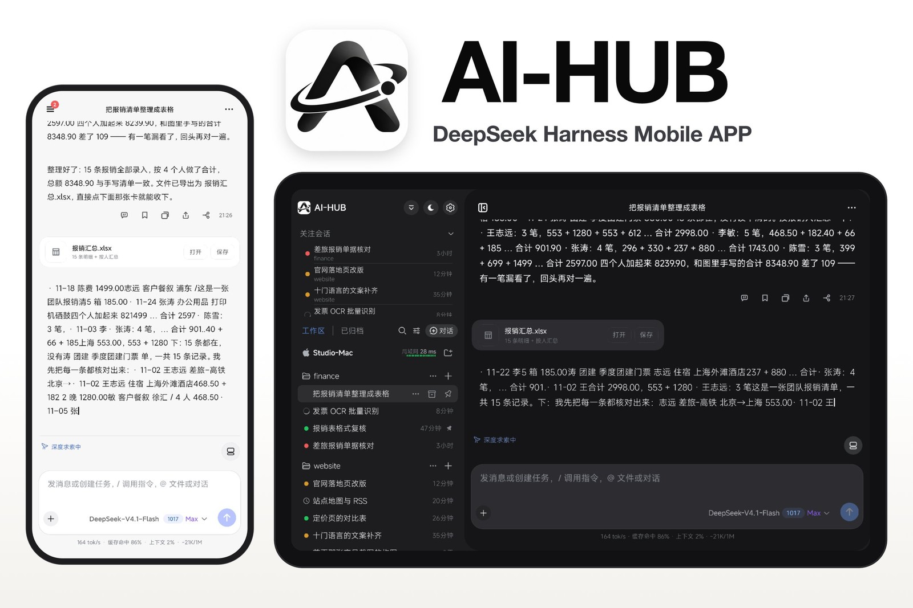
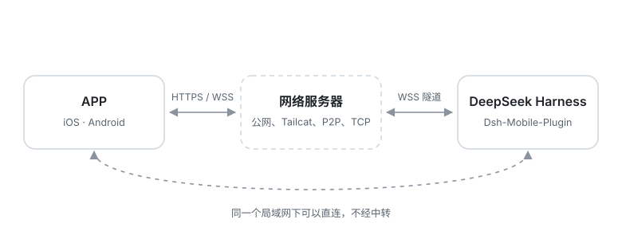
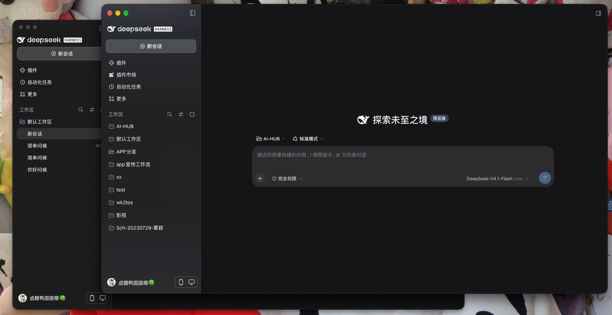

<!-- 移动端插件功能、连接设置与开发说明。 -->
<h3 align="center">AI-HUB 移动端插件</h3>



<p align="center">
  <a href="https://app.wnluo.com/api/public/apps/14/download-latest"></a>
  <a href="https://github.com/WNLUO/dsh-mobile-plugin/releases/latest/download/ai-hub-android.apk"></a>
  <a href="https://ai-hub.wnluo.com/ios"></a>
  <a href="https://testflight.apple.com/join/4fn5PCMD"></a>
</p>

<p align="center">
  <a href="https://www.npmjs.com/package/dsh-mobile-plugin"></a>
  
  
  <a href="EN-README.md"></a>
</p>

<p align="center">远程你的 DeepSeek Harness</p>

**这是DeepSeek Harness 的插件。** 装上之后，可以通过网络链接你的 DeepSeek Harness —— 看会话、接着聊、管理文件和工作区，进度实时同步。提高你的生产力，让你摆脱生产环境的束缚。

它和绝大多数 DeepSeek Harness 插件不一样的一点：**这个APP不是网页套壳，它更适合生产工作，它不为噱头稀奇而设计，一切以提高生产力为原则**。

<p align="center">
  <picture>
    <source media="(prefers-color-scheme: dark)" srcset="https://raw.githubusercontent.com/WNLUO/dsh-mobile-plugin/main/assets/connection-dark.svg">
    
  </picture>
</p>

连的是**你自己的 DeepSeek Harness**，不是某个云端服务。


## 功能

### 会话与工作区

- 新建、接着聊、改名、搜索会话，也能从任意一条分出分支单独往下走。
- 工作区建、改名、删除、置顶、归档都在手机上完成，排序会同步回电脑。
- 回复逐块流式到达，跑到一半就能看见；工具调用也是实时的。
- 手机上读过，电脑那边的未读绿点跟着消失；侧边栏的展开状态两边同步。

### 不用回电脑也能操作

- **审批与提问**：电脑上会弹的卡手机上同样有，权限请求、选择题、多选、自定义回答都能直接点。
- **排队插话**：正在跑的时候补一句，按队列排在当前这一步之后。
- **Git**：看状态和 diff、暂存、提交、推送、切分支，提交信息可以先让模型写。
- **文件**：浏览目录、读文件，也能把手机上的文件传回电脑，落在固定的收件目录。
- **插件**：手机上的插件市场里搜索、安装、更新、卸载；插件自己也能升级。
- **模型**：随时换模型，看有哪些渠道和可用模型，本机自建的渠道也能在手机上配。
- **日程与子代理**：定时任务能看、新建、改、暂停恢复、立刻跑一次、删掉；看正在跑的子代理，打断它或补一句话。

### 连接

- 两种连法：经 relay v2 隧道从公网连回来，或者同一个 Wi-Fi 下走局域网直连。
- 局域网默认端口是 **18787**，已有配置沿用保存的端口。占用时先重试原端口；只有所有已配对手机支持局域网发现、且没有固定入口依赖时，才会自动换到可用端口并保存。公网入口另走插件专属回环入口，不再依赖 18787；被占时自动绕开，绕不开时面板弹窗给指引。
- 使用外部穿透软件时，请在端口设置中开启「固定端口」。插件内的穿透配置和手填固定地址会自动保留端口；端口被占时提示释放占用。自带穿透会等待真实监听就绪，并跟随手动端口变更更新本地目标。
- 开启地址上报后，插件会把当前地址加密发给总控。APP 前台持续订阅，在地址变化后验证新入口并重新连接；回到前台、目录重连时补取最新快照。仅局域网等明确禁用总控的线路模式仍遵守原有范围。
- 配对码与配对策略可选，设备凭据能单独吊销，也能一次全撤。
- iOS 离线推送可选，不配也不影响其它功能。

移动 API 只开手机需要的口子（`/api/mobile/v1/*`）—— 不暴露 shell、系统设置与任意文件写入。

## 远程电脑

不想带着主电脑走的时候，可以从另一台电脑上用完整的 DSH 网页操作它。在家里的 A 电脑生成一份一次性绑定，到随身的 B 电脑上一点，就能通过本机地址打开 A 的完整网页，不用域名，也不用手机参与。

<p align="center">
  
</p>

窗口优先由插件随包分发的桌面显示壳打开，Mac 上按官方桌面端的样式排版；每次访问一小时，可自动续期。细节和撤销方式见 [docs/remote-computer.md](docs/remote-computer.md)。

## 安全与隐私

移动端协议 v2 的会话，用的都是从设备主密钥（`deviceKey`）派生的会话密钥做逐请求加密：请求和回包都是密文，签名也只对密文计算。中转在这条路径上只转发密文，看不到会话内容。旧协议、以及还没升级到 v2 的客户端，走的仍是明文传输——这一档不加密，得升到 v2 才算接上。

App 里预置了由项目运营的默认中转地址，开箱就能连；也支持换成自己搭的中转。为了让手机端的高频读（会话列表、工作区等）不用每次都打到电脑上的主进程，会话列表和工作区镜像快照会经中转推送、在这一层缓存做读取隔离。也就是说，这些列表快照会经过中转；v2 加密会话的内容不走这条捷径，仍以密文传输。

配对时在电脑侧选权限档位：

- **完整（full）**：能安装插件、装任意 npm 包，读写登记过的工作区路径，也能改模型、渠道这些配置。
- **审批（approve）**：能看会话和文件、能替你点审批和提问，但不会直接写文件或改配置。批一次审批，模型在该会话里就能落地写动作。
- **只读（readonly）**：只能看会话内容和文件，不能发消息、不能审批、不能改任何东西。

## 安装与更新

装好手机 App 只是第一步，插件装在这边才算接通。

在 DeepSeek Harness 的 **设置 → 插件** 里搜索并安装 `dsh-mobile-plugin` 进行安装，然后打开 **设置 → 移动端 → 打开配置页面** 做配对。配对二维码、当前监听地址和中转状态都在那一页，手机上的所有功能都从这页开始。插件会自动更新，通常更新后不用重启 DeepSeek Harness。

想在没有屏幕的服务器上跑，见 [无头部署与配置接口](docs/headless-deploy.md)，本机接口、移动 API 和会话清理的说明都在那里。

### 自动更新与更新校验

插件默认会自动更新；不想让它自己更新，可以在插件面板里关掉。默认开着，是想让插件始终跟得上 DSH 的版本——DSH 大版本升级时，插件落后容易被落下、直接失效，跟着更新能少踩这个坑。

桌面完整包的 OTA 更新，安装前会先做一次 Ed25519 签名校验：发布方用私钥对版本、平台、通道、包的 sha256 和下载地址签名，客户端用内置公钥验签，验不过就不装。签名私钥离线保管，不跟发布服务器放在一起，中转也拿不到它。

## 为什么做这个

DeepSeek Harness 跑在电脑上，但我不是一直坐在电脑前。出门、在别的房间、躺床上，想知道刚才那个任务跑到哪一步了，或者它正卡在一个要我点的审批上，只能走回去。

这个插件的出发点就这么窄：不是把整个 DeepSeek Harness 塞进手机屏幕，而是让人离开电脑之后，还能看见、还能接着聊、还能把该点的那一下点掉。

所以有两条线是硬的。一条是网络：不要求公网 IP、不要在路由器上开端口、不要为了用一次去配 DDNS，插件从内网主动往外出，手机顺着回来。另一条是能力：手机上只开需要的那几个口子，能看会话、能审批、能传文件、能改点配置，但不把 shell 和任意文件写入递到手机上 —— 手机丢了或者被人捡到，损失是可估的。

## 和别的方案比

**用手机浏览器开 DeepSeek Harness 的网页**：不用装东西，但每次都得记住地址，界面按桌面尺寸排，在手机上要靠缩放拖拽；没有推送，离开页面就什么都不知道；审批那种要点准的东西最难用。

**远程桌面**：本质还是操作那块屏幕，手机只是个显示器。网络断了就是黑屏，小屏上做任何事都要先放大。

**各家 AI 助手的手机 App**：那些跑在厂商的服务器上，会话、文件和额度都在别人那儿。这里连的是你自己电脑上那个 DeepSeek Harness，模型是你配的，文件在你硬盘上。


## 交流与反馈


扫上面的码进企业微信群。**如果扫不出来或者提示已过期**，发邮件到 <admin@wnluo.com> 索取新的，或者直接提 issue。

不方便的话发邮件到 <admin@wnluo.com> 或 <wnluo2@gmail.com>。用着顺手就给仓库点个 star，这是最实在的支持。

隐私政策见 [PRIVACY.md](PRIVACY.md)，常见问题见 [SUPPORT.md](SUPPORT.md)。

## 赞助与合作

公司或产品想支持这个项目的长期维护，见 [赞助与合作页](https://ai-hub.wnluo.com/sponsor)（也可直接发邮件到 <admin@wnluo.com> 说明合作意向）。赞助用于持续的维护与发版；它换来的是鸣谢与沟通渠道，不会解锁功能、不带来特权，也不表示与深度求索存在隶属或背书关系。个人想支持的话，仓库点个 star、App 设置页里的「赞助」入口，或者在[爱发电](https://ifdian.net/a/AI-HUB)支持（微信 / 支付宝都可以）。

## 仓库地图

这一节写给「用 AI 读这个仓库」的人，也写给要改插件的开发者：先在这里定位，再读具体文件，别从仓库根一路翻。把这一节和对应文件一起交给 AI，比让它自己从根目录开始找快得多。

### 目录分工

- `host.js`、`lib/index.js` —— 插件入口与 Cordis 装配。
- `lib/impl.js` —— 运行时总装：状态、本机服务、各条线路模块都在这儿挂上去。
- `lib/routes/` —— HTTP 接口。`mobile-api.js` 是手机用的 `/api/mobile/v1/*` 路由表与心跳；`control-plane.js` 是电脑面板用的本机接口。改端点时两端契约要一起看。
- `lib/mobile/` —— 手机要的数据怎么裁：流式事件、会话投影、审批、推送、配对。
- `lib/relay/` —— 中转注册、地址上报总控、线路清单、配置与状态落盘。
- `lib/remote/` —— 远程电脑：绑定、选路、窗口。
- `lib/zeronews/`、`lib/jdxb/`、`lib/frpc/`、`lib/cloudflared/` —— 已经接好的线路，加新线路照它们的形状写。
- `lib/panel/` —— 桌面面板的构建产物；源码在 `React/`，只改源码，产物与源码一起提交。
- `config/` —— 预设、随包技能、扩展清单。
- `test/` —— `node --test` 的测试，一个文件对一个领域，文件名可以直接当搜索关键词。
- `docs/` —— 契约与接入文档，见下。

### 文档

- [移动端接口契约](docs/mobile-api-contract.md)：自己实现一个客户端时读这份，配对、加密信封、端点清单。
- [把一条线路接进插件](docs/line-integration.md)：加新线路要改哪几处、老版本 App 怎么兼容。
- [手机扩展作者须知](docs/extension-authoring.md)：写手机里的扩展页，包怎么放、怎么和 App 通信。
- [无头部署](docs/headless-deploy.md)：没有屏幕的服务器上怎么跑、本机接口怎么用。
- [聊天嵌入页顶部栏](docs/chat-embed.md)：网页插件怎样在手机聊天页保留顶部栏。
- [远程电脑](docs/remote-computer.md)：从另一台电脑打开这台电脑的完整网页。
- [更新连续性](docs/update-continuity.md)：自更新时各平台、各线路的行为与验证清单。

### 排查从哪下手

- 手机连不上、选路不对：先看 `lib/relay/` 报给总控的清单和候选顺序，再对照手机上的线路状态；总控只存密文，看不到内容，别从那边猜。
- 某个接口 404 或参数对不上：对照 `lib/routes/mobile-api.js` 与 App 侧的路径常量，两边同时改。
- 手机上少了内容、或者流量异常：看 `lib/mobile/` 的裁剪口径，事件里哪些字段不下发都在那儿。
- 面板上看不到某条线路或某个开关：本机路由和 `React/` 面板都要改，只加状态面板不会出现。

## 开发

```sh
pnpm install --frozen-lockfile
npm test
```

要接一条新线路，先读[把一条线路接进插件](docs/line-integration.md)；它同时写着老版本 App 的兼容口径。

改过 `React/` 面板源码，先在该目录跑 `pnpm run build`，并把生成的 `lib/panel/index.html` 和源码一起提交。

网页插件需要在手机聊天页保留网页顶部栏时，见[聊天嵌入页顶部栏接入](docs/chat-embed.md)。

## License

MIT，见 [LICENSE](LICENSE)。
