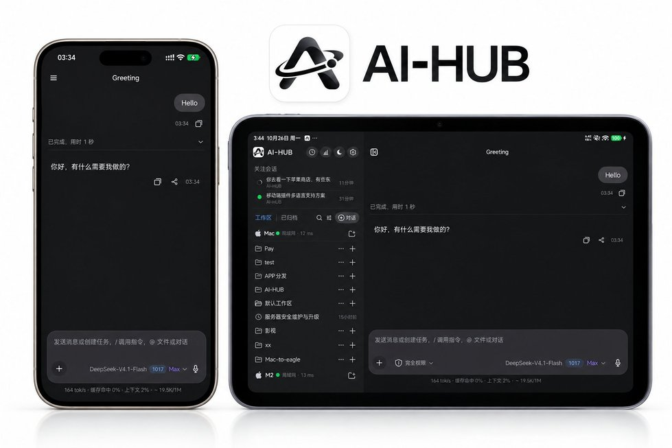

<h3 align="center">AI-HUB 移动端插件</h3>

<p align="center">
  
</p>

<p align="center">
  <a href="https://app.wnluo.com/public/apps/14"></a>
  <a href="https://github.com/WNLUO/dsh-mobile-plugin/releases/latest/download/ai-hub-android.apk"></a>
  <a href="https://apps.apple.com/us/app/ai-hub/id6821681438"></a>
  <a href="https://testflight.apple.com/join/4fn5PCMD"></a>
</p>

<p align="center">
  <a href="https://www.npmjs.com/package/dsh-mobile-plugin"></a>
  
  
  <a href="EN-README.md"></a>
</p>

<p align="center">电脑上开着的 DSH，手机上接着用。</p>

**AI-HUB 的手机端插件。** 装在电脑这边，手机 App 就通过一条中转隧道或局域网配对连进你的 DSH —— 看会话、接着聊、管理文件和工作区，进度实时同步。它也可以脱离桌面外壳单独跑在服务器上，当作无头宿主用。

<p align="center">
  <picture>
    <source media="(prefers-color-scheme: dark)" srcset="https://raw.githubusercontent.com/WNLUO/dsh-mobile-plugin/main/assets/connection-dark.svg">
    
  </picture>
</p>

手机连的是**你自己那台电脑上的 DSH**，不是某个云端服务。电脑不用公网 IP，也不用在路由器上开端口：插件从内网主动往外建一条隧道，手机沿这条路回来。

## 功能

### 会话与工作区

- 新建、接着聊、改名、搜索会话，也能从任意一条分出分支单独往下走。
- 工作区建、改名、删除、置顶、归档都在手机上完成，手机端排的顺序会同步回电脑。
- 回复逐块流式到达，跑到一半就能看见内容，工具调用也是实时的。
- 空闲会话自动进归档，列表里不再占位，日志不删。
- 手机上读过，电脑那边的未读绿点跟着消失；电脑侧边栏的展开、折叠状态同步到手机，两边结构一样。

### 不用回电脑也能操作

- **审批与提问**：电脑上会弹的卡手机同样有，权限请求、选择题、多选、自定义回答都能直接点。
- **排队插话**：正在跑的时候补一句，按队列排在当前这一步之后。
- **Git**：看状态和 diff、暂存、提交、推送、切分支，提交信息可以先让模型写。
- **文件**：浏览目录、读文件，也能把手机上的文件传回电脑，落在固定的收件目录。
- **插件**：手机上的插件市场里搜索、安装、更新、卸载；插件自己也能升级到新版。
- **模型**：随时换模型，看有哪些渠道和可用模型，本机自建的渠道也能直接在手机上配。
- **日程与子代理**：查看定时任务、删掉不要的；看正在跑的子代理，打断它或者补一句话。

### 连接

- 两种连法：经 relay v2 隧道从公网连回来，或者同一个 Wi-Fi 下走局域网直连。
- 配对码与配对策略可选，设备凭据能单独吊销，也能一次把全部撤掉。
- iOS 离线推送可选，不配也不影响其它功能。

移动 API 只开手机需要的口子（`/api/mobile/v1/*`）—— 不暴露 shell、系统设置与任意文件写入。

## 安装与更新

装好手机 App 只是第一步，插件装在这边才算接通。

### 桌面端

在 DSH 的 **设置 → 插件** 里搜索并安装 `dsh-mobile-plugin`，然后打开 **设置 → 移动端 → 打开配置页面** 做配对。插件市场负责检查和安装更新，通常更新后不用重启 DSH。

### 无头 Host（Linux）

需要 Node.js、pnpm，以及可用的 DSH 插件宿主依赖。仓库里的 `host.js` 就是独立入口：

```sh
pnpm install --frozen-lockfile
DSH_HOME=/opt/dsh-mobile/.dsh DSH_MOBILE_PROFILE=mobile node host.js
```

`DSH_HOME` 是数据根目录，默认 `~/.dsh`；`DSH_MOBILE_PROFILE` 是 profile 名称，默认 `mobile`。无头 Host 的 Web 服务默认只监听 `127.0.0.1:3080`，不对局域网直接开放。

配置接口只限本机访问，看状态和拿配对信息：

```sh
curl http://127.0.0.1:3080/api/relay/status
curl http://127.0.0.1:3080/api/relay/pairing
```

### 无头部署

无头服务器上，启动器和插件本体是分开管的：启动器由部署流程同步到 `/opt/dsh-mobile/`，插件本体装进 profile：

```sh
cd <DSH_HOME>/profiles/<profile>
pnpm add dsh-mobile-plugin@<版本>
```

宿主优先挂 profile 里装的那份，没装才用源码树版本。设备凭据库随 npm 包一起发，不用单独装。仓库锁文件用 `pnpm install --frozen-lockfile`。

> 别用 `npm install --legacy-peer-deps` 装插件；正式安装走 DSH 插件市场。

## 配置与 API

无头运行时用这几个本机接口管远程连接：

- `POST /api/relay/toggle`：开或关远程控制。
- `POST /api/relay/regenerate`：重新生成配对码。
- `POST /api/relay/config`：设置 `relayUrl`、`lanEnabled`、`lanPort`、`name` 和 `pairingPolicy`。
- `POST /api/relay/reconnect`：重连隧道与局域网代理。

移动 API 要 Bearer token。设备事件流 `GET /api/mobile/v1/events/stream` 用 SSE 转发宿主事件。建会话时可以传 `workspaceId` 或 `cwd`，前者优先，并会把会话归进那个工作区；手机端的排序同样会同步到宿主工作区。

配对策略默认 `code`，凭配对码放行；设成 `deny` 就拒绝所有新配对。配对请求可以带设备信息，App 会发 `id`、`deviceId`、`name`、`platform`、`osVersion` 和 `appVersion`，局域网代理与中转会补上它们观察到的手机 IP。

`session_cleanup` 能归档会话，也能永久删除归档过的会话，删除前要显式确认，删掉不可恢复。**删除是排队的**：会话立刻从列表里消失，日志和投影缓存等宿主下次启动才从磁盘上清掉 —— 宿主没有「删除会话」的接口，运行中从它脚底下删文件会带走整个宿主进程。

## 为什么做这个

DSH 跑在电脑上，但我不是一直坐在电脑前。出门、在别的房间、躺床上，想知道刚才那个任务跑到哪一步了，或者它正卡在一个要我点的审批上，只能走回去。

这个插件的出发点就这么窄：不是把整个 DSH 塞进手机屏幕，而是让人离开电脑之后，还能看见、还能接着聊、还能把该点的那一下点掉。

所以有两条线是硬的。一条是网络：不要求公网 IP、不要在路由器上开端口、不要为了用一次去配 DDNS，插件从内网主动往外出，手机顺着回来。另一条是能力：手机上只开需要的那几个口子，能看会话、能审批、能传文件、能改点配置，但不把 shell 和任意文件写入递到手机上 —— 手机丢了或者被人捡到，损失是可估的。

## 和别的方案比

**用手机浏览器开 DSH 的网页**：不用装东西，但每次都得记住地址，界面按桌面尺寸排，在手机上要靠缩放拖拽；没有推送，离开页面就什么都不知道；审批那种要点准的东西最难用。

**远程桌面**：本质还是操作那块屏幕，手机只是个显示器。网络断了就是黑屏，小屏上做任何事都要先放大。

**各家 AI 助手的手机 App**：那些跑在厂商的服务器上，会话、文件和额度都在别人那儿。这里连的是你自己电脑上那个 DSH，模型是你配的，文件在你硬盘上。

## 交流与反馈

<p align="center">
  
</p>

扫上面的码进企业微信群。不方便的话发邮件到 <admin@wnluo.com> 或 <wnluo2@gmail.com>。用着顺手就给仓库点个 star，这是最实在的支持。

隐私政策见 [PRIVACY.md](PRIVACY.md)，常见问题见 [SUPPORT.md](SUPPORT.md)。

## 开发

```sh
pnpm install --frozen-lockfile
npm test
```

改过 `React/` 面板源码，先在该目录跑 `pnpm run build`，并把生成的 `lib/panel/index.html` 和源码一起提交。

## License

MIT，见 [LICENSE](LICENSE)。
